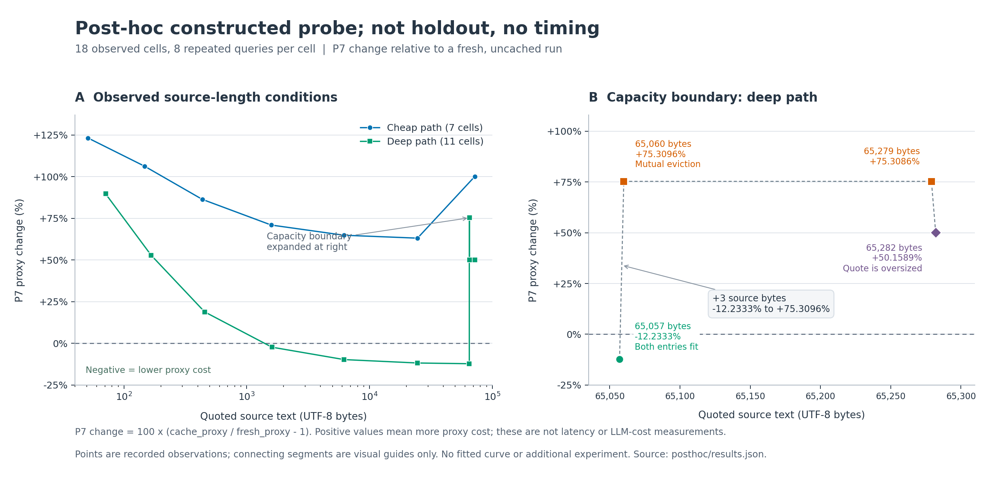

# Phase 07 — 순수 해석 결과 재사용의 보존 조건과 비용 경계

**기존 결과와 정확히 같은 출력을 내면서 파서 실행을 줄이는 데는 성공했다.
그러나 동결한 새 평가에서 전체 비용 proxy와 로컬 실행시간의 이득은 얻지 못했다.**
Memoization과 LRU 자체를 새로운 알고리즘이라고 주장하지 않는다. 이번 기여는
이 연구 엔진에서 무엇까지 재사용해도 되는지 명시하고, 실제 재사용과 전체 이득을
분리해 검증하고, 비용이 뒤집히는 조건을 수식과 실행으로 연결한 것이다.

기준은 Phase06 `13d166dc106fa3ab33128ad0626679fafdce5019`다. 추가 파일은
`research/phase07/` 안에 있으며 이전 동결 자료와 SOOM 운영은 변경하지 않았다.

## 먼저 읽을 파일

- [HANDOFF_BACK.md](HANDOFF_BACK.md): `docs/RETURN_TEMPLATE.md` 형식의 전체 반환 문서.
- [PROTOCOL.md](PROTOCOL.md), [THEORY.md](THEORY.md): 실행 전 가설, 정확 동등성 정리, 비용식.
- [results/holdout_results.json](results/holdout_results.json): 주평가의 분모·상태·family별 비용.
- [POSTFREEZE_REVIEW.md](POSTFREEZE_REVIEW.md): 별도 재현과 원시 행 재집계.
- [BOUNDARY_ANALYSIS.md](BOUNDARY_ANALYSIS.md): 주평가와 분리한 사후 비용·용량 경계 분석.

## 주평가 결과

10 family × 3 parameterization × 10 step = **30 stream / 300 step**이다.
동일 모델의 별도 작성자가 만든 합성 자료이며 외부 블라인드 자연어 평가가 아니다.
네 방법의 1,200행을 독립 대화 1,200개로 세지 않는다.

| 지표 | 기존 `fresh` | 지속 캐시 `lru` |
|---|---:|---:|
| 실제 순수 파서 실행 | 2,292 | 750 (**−67.28%**) |
| 파서 입력 바이트 | 932,814 | 789,322 (**−15.38%**) |
| snapshot 검증 바이트 | 1,053,198 | 1,053,198 |
| 출력 UTF-8 bytes | 107,223 | 107,223 |
| 캐시 관리 proxy | 0 | 2,391,270 |
| 전체 P7 proxy | 2,093,235 | 4,341,013 (**+107.38%**) |
| 300질문 전체 로컬 시간 중앙값 | 20.157 ms | 27.126 ms (**+34.57%**) |

P7은 출력·검증·실제 파서 입력·key 생성/probe·값 encoding/read/write의 **동일 가중
논리적 바이트 지표**다. 실제 RAM 전송량, LLM 토큰, 과금, 답변 품질의 측정이 아니다.
시간은 계측판의 7회 로컬 반복이며 추론·렌더링·캐시 관리를 포함한다. 별도 재현에서는
전체 시간 변화가 **+49.69%**였다. 한 반복 질문 family의 −10.56%는 재현에서 +2.37%로
바뀌었으므로 안정적인 속도 개선으로 보고하지 않는다.

실제 실행 감소는 228/300질문에서 발생했지만, P7이 줄어든 질문은 0/300이고
누적 P7 손익분기점을 지난 stream도 0/30이다. `reset`보다 좋은 수치를
기존 `fresh`보다 좋은 것으로 바꾸어 말하지 않는다.

### 답변 범위와 검증

네 방법 모두 `certified_model` 243, `opaque_fallback` 21, `ambiguous` 15,
`unsupported_query` 9, `integrity_failure` 12다. 전체 이력 출력은 30건이다.
모형 안의 단일값 답변 범위는 243/300 = 81%이며 기준 구현과 같다.

- 결과·선택·근거 렌더·trace의 동등성 실패: 0.
- false certification: **0/243**; containment 위반: **0/267**.
- gold 적용: 276/300. 무효 snapshot 12건과 entity membership 변경 12건은 제외했다.
- 기존 Phase05 672질문과 Phase06 384질문은 회귀 검사이며 새 독립 평가가 아니다.

`certified_model`은 제한된 의미 모형의 판정이다. 실제 사실성이나 작업 실행의 인증이 아니다.

## 수학적 핵심

단계 함수가 결정적·순수하고 의미 버전과 ordered entities 및 정확한 원문을 key에
포함하며, immutable 결과를 stage별로 저장하고 현재 질문의 분기와 상태 실행을
그대로 수행하면 **캐시 용량이나 축출 여부와 무관하게 기존 실행과 관찰적으로 같다.**
저장하지 않는 것은 현재 질문의 TOP, 답, 선택, 참조 당시의 값이다.

완전히 warm인 한 기록의 길이를 L, context 길이를 C, 재사용 payload 길이를 R,
원래 요청한 stage 수를 m이라 하면, 질의당 context 생성비를 제외한 비용 차이는

\[
\Delta P_7=(2-m)L+C+R.
\]

이 proxy에서 1·2단계 기록은 warm이어도 이득이 없다. 3단계 기록은
`L > C + R`에서 가능성이 생기지만 초기 구축비와 용량 경계까지 통과해야 한다.
이것은 실제 CPU의 정보이론적 하한이 아니다.

사후에 구성한 2기록·8반복 진단에서는 3단계 quote가 65,057 bytes일 때 P7이
12.23% 줄고, 65,060 bytes에서는 두 항목이 서로 축출되어 75.31% 늘었다.
18 cell / 144질문에서 비용식 잔차와 동등성 실패는 모두 0이었다. 이는
**주평가 후 고른 조건에서의 수식 검사**이며 주평가의 실패를 대체하는 새 독립 성과가 아니다.



## 재현

연구 실행은 Python 표준 라이브러리만 필요하다. 원본 결과를 덮어쓰지 않는 새 경로를 쓴다.

```bash
python tools/verify_archive.py
python research/phase07/holdout_builder.py --check
python research/phase07/run_study.py --run \
  --output /tmp/soom-phase07-repro-new \
  --compare research/phase07/results
python research/phase07/cost_boundary_probe.py \
  --output /tmp/soom-phase07-boundary-new.json
```

5개 결정적 산출물의 바이트 동일성을 별도 실행에서 확인했다. 시간값은 동일성 비교 대상이
아니다. `freeze.json`을 다시 생성하지 않는다. 선택적인 그림 재생성에는 matplotlib가 필요하다.

```bash
MPLCONFIGDIR=/tmp/soom-phase07-mpl python research/phase07/plot_boundary.py
```

다음 한 가지 제안은 **의미 선택기를 고정한 채 비용과 동시 보관 크기를 고려하는
선택적 재사용 정책**이다. 먼저 단계를 실행해야 얻는 정보를 admission에 사용할 때의
선행 비용까지 포함해야 한다. 이번 사후 사례로 정책을 개발한다면 반드시 새 stream으로
평가해야 한다. 이번 단계에서는 그 정책을 구현하거나 성과를 주장하지 않았다.
