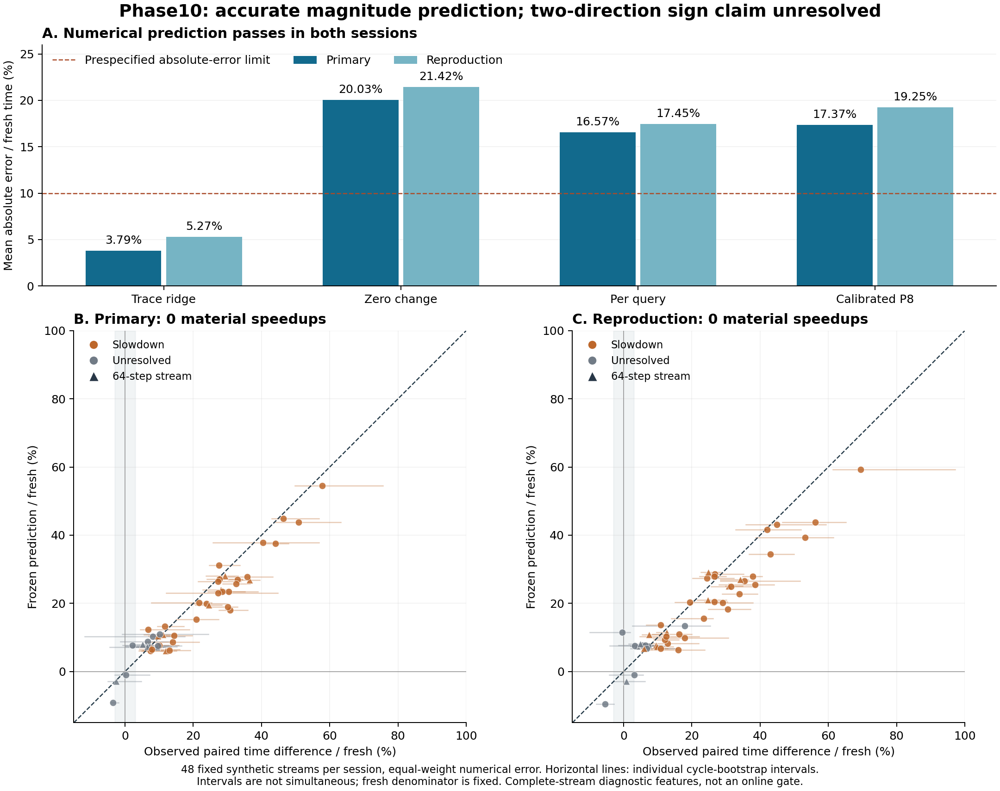

# Phase10 — 고정 trace의 시간차 예측

**수치 예측은 두 session에서 사전 기준을 통과했다. 양방향 손익 판별은 필요한
speedup class가 없어 미확인이다. 결합 H10을 채택하지 않았다.**

직접 기준은 Phase09 공개 완료 `0c08785fcee9ab146f33fa8a7d94a4b7700833aa`다.
기존 fresh/selective 비계측 실행과 정책을 그대로 import한다. Phase01–09의
동결 코드·자료·결과 및 SOOM 운영은 바꾸지 않았다.

## 결과

주 지표는 전체 48개 stream에 동일한 가중치를 주는
`mean(abs(predicted time difference − median of observed paired time differences) / median fresh time)`다.
모형은 완료된 전체 stream의 별도 실행 trace를 쓴다. 온라인 gate가 아니다.

| 예측기 | 원본 평균 오차 | 별도 재현 평균 오차 |
|---|---:|---:|
| 고정 10-feature ridge | **3.793286%** | **5.267747%** |
| Zero change | 20.033760% | 21.421886% |
| Per-query | 16.568260% | 17.448134% |
| Calibrated P8 | 17.368123% | 19.248427% |

최고 baseline 대비 오차는 77.105103% / 69.809109% 감소했다. E≤10%와
최고 baseline 대비 25% 감소 조건을 모두 통과했다. 모든 stream의 점별
오차가 10% 이하라는 뜻은 아니다.

Material label은 원본 `0 speedup / 35 slowdown / 13 unresolved`, 재현
`0 / 36 / 12`다. 두 session 공통 resolved 집합은 `0 / 32`이며 BA는
정의되지 않는다. 음의 점추정은 존재했지만 사전에 정한 3% margin·구간
규칙을 충족하지 못했다. 자료나 반복 수를 늘리지 않았다.

실제 전체 workload의 paired 차이 중앙값을 fresh 중앙값으로 나눈 보조값은
**+16.372704% / +18.495192%**였다. 좋아진 것은 시간차의 예측 오차다.
실행 정책을 가속한 연구가 아니며 predictor의 실행비까지 포함한 운영 이득도
검증하지 않았다.



## 먼저 읽을 자료

1. [HANDOFF_BACK.md](HANDOFF_BACK.md): 출발점·계약·결과·실패·재현·다음 한 가지 연구.
2. [PROTOCOL.md](PROTOCOL.md): 결과 전 고정한 가설·자료 구분·측정·판정·중단 규칙.
3. [THEORY.md](THEORY.md): 보존 승계, ridge, 충돌·상태·horizon·중앙값·부호의 정리와 반례.
4. [POSTFREEZE_REVIEW.md](POSTFREEZE_REVIEW.md): 수치 성공과 방향 미확인의 구별.
5. [DATA_REVIEW.md](DATA_REVIEW.md): 분포·중복·길이 지배·cold 비용·오차 사례.
6. [REPRODUCTION_REVIEW.md](REPRODUCTION_REVIEW.md): 실제 별도 실행과 독립 raw 재집계.

개발 검토는 [MATH_REVIEW.md](MATH_REVIEW.md),
[EVALUATOR_REVIEW.md](EVALUATOR_REVIEW.md),
[DEVELOPMENT_AUDIT.md](DEVELOPMENT_AUDIT.md)에 있다.
Phase09의 상속 검증은 [INHERITANCE_AUDIT.md](INHERITANCE_AUDIT.md),
새 자료의 작성 경계는 [docs/HOLDOUT_AUTHOR.md](docs/HOLDOUT_AUTHOR.md)다.

## 결정적 증거와 시간 증거

- [combined_results.json](combined_results.json): 두 session의 결합 판정·보존·비용.
- [recount_results.json](recount_results.json): 구현 함수를 import하지 않은 별도 재집계.
- [results/predictions.json](results/predictions.json): 새 timing 전에 봉인한 48개 예측.
- [results/timing.json](results/timing.json), [reproduction/timing.json](reproduction/timing.json): 원시 시간·warmup·순서·구간.
- [results/holdout_rows.json.gz](results/holdout_rows.json.gz), [results/holdout_states.json.gz](results/holdout_states.json.gz): 4,704방법행·1,176상태 witness.
- [calibration/model.json](calibration/model.json): 개발 자료에서 한 번 정한 coefficient.
- [freeze.json](freeze.json), [freeze_commit.json](freeze_commit.json), [pre_evaluation.bundle](pre_evaluation.bundle): 로컬 동결 원본.

별도 재현의 결정적 파일 8개는 byte-identical이었다. `reproduction/`은
그 동일 session의 파일을 완전 복사한 것이며 추가 실험이나 독립 표본이 아니다.
루트의 `reproduction_*.json`도 같은 실행의 편의 복사본이다. 시간 자체는
byte 동일성을 요구하지 않는다. 모든 새 결과는 같은 모델의 역할 분리이며
외부 독립 검증이 아니다. 로컬 freeze는 외부 사전 등록이 아니다.

## 실행

핵심 실행은 Python 3.12 표준 라이브러리만 사용한다. 저장소 root에서:

```bash
python tools/verify_archive.py
python research/phase10/run_study.py --verify
python research/phase10/holdout_builder.py --check
git bundle verify research/phase10/pre_evaluation.bundle
python research/phase10/recount_results.py --reproduction research/phase10/reproduction --output /tmp/soom-phase10-stored-recount.json
```

새 시간 재현은 아래와 같다. 기존 output이 있으면 새로운 경로를 쓴다.

```bash
python research/phase10/run_study.py --run --session reproduction --output /tmp/soom-phase10-your-reproduction --compare research/phase10/results
python research/phase10/recount_results.py --reproduction /tmp/soom-phase10-your-reproduction --output /tmp/soom-phase10-your-recount.json
```

원래 calibration은 저장된 `calibration/`의 원시값으로 재계산해 동결 모델과
같음을 확인한다. 새 시간으로 학습해 이번 결과를 소급해서 바꾸지 않는다.
그림 재생성만 Matplotlib 3.10.8을 사용한다.

```bash
MPLCONFIGDIR=/tmp/soom-phase10-mpl python research/phase10/plot_results.py --output /tmp/soom-phase10-figures
```

## 무엇을 증명하고 무엇을 증명하지 않았는가

같은 입력 prefix의 Obs·정책 상태·실제 trace 보존은 확인했다. 예측용 10개
feature는 정책의 충분 상태가 아니다. 실제 구성한 `A,B,C`/`B,A,C`가 같은
feature와 다른 resident를 가지며 같은 다음 A에서 재사용 호출이 0/3으로
갈린다. Ridge의 유일성은 CPU 단가의 인과 식별을 뜻하지 않는다.

자유 자연어 의미 정확성, 미완료 요청·실행 증거의 일반 보존, LLM token·요금·
품질, 새 머신 일반화, 온라인 선택 이득은 평가하지 않았다. 다음 후보는
짧은 raw의 eager encoding을 eligibility 뒤로 늦추는 **단일 변경**의 보존과
실제 시간을 검증하는 것이다. 이번 단계에서 구현하지 않았다.

## GitHub 전달

Branch: `research/phase10-time-prediction`. Base: `research/phase09-instrumentation-erasure`.
PR #1–#4는 재확인 당시 모두 open/unmerged였다. 공개 PR과 원격/local tree
동일성은 전달 후 [DELIVERY.json](DELIVERY.json)과 PR 본문에 기록한다.
기존 branch를 덮어쓰거나 PR을 merge하지 않는다.
